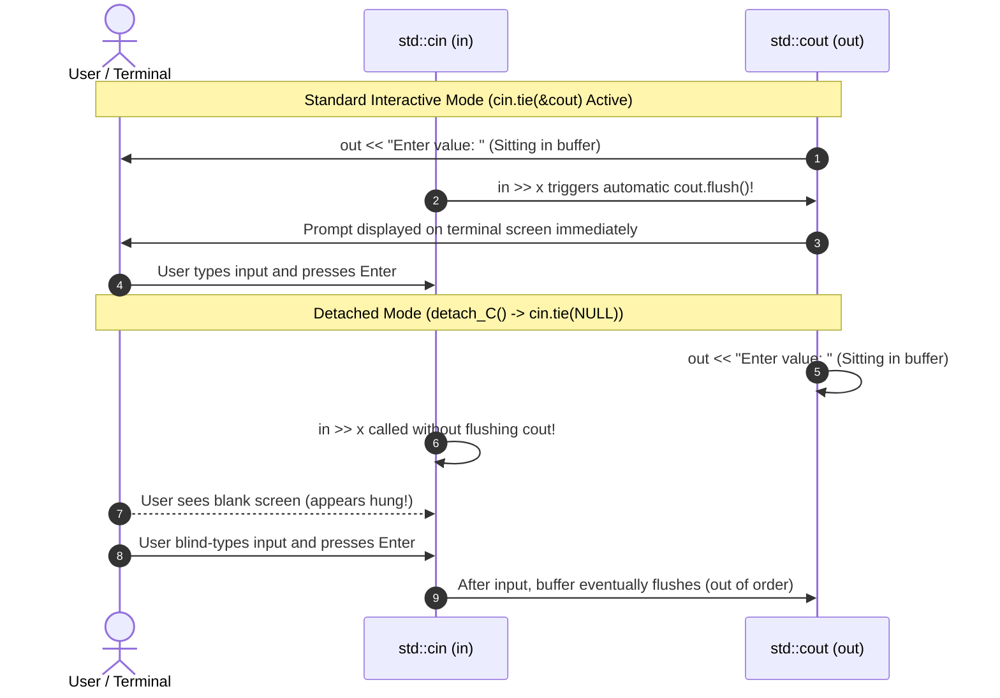

# Technical Report: Architectural & Code Analysis of `b1t_Lang` DSL

This report provides an architectural overview and technical analysis of the **`b1t_Lang`** Domain-Specific Language (DSL) developed for Assignment 4. It details each constituent source and header file in the system: [`test.cpp`](file:///d:/GitHub/UITS/Compiler-Lab-Codes/Project.Compiler/test.cpp), [`main.h`](file:///d:/GitHub/UITS/Compiler-Lab-Codes/Project.Compiler/main.h), [`main.cpp`](file:///d:/GitHub/UITS/Compiler-Lab-Codes/Project.Compiler/main.cpp), [`common.h`](file:///d:/GitHub/UITS/Compiler-Lab-Codes/Project.Compiler/common.h), and [`all.h`](file:///d:/GitHub/UITS/Compiler-Lab-Codes/Project.Compiler/all.h), highlighting [`test.cpp`](file:///d:/GitHub/UITS/Compiler-Lab-Codes/Project.Compiler/test.cpp) as the consumer template and snippet, and detailing critical runtime gotchas and preprocessor trade-offs.

---

## Table of Contents
1. [1. Executive Summary & Purpose](#1-executive-summary--purpose)
2. [2. System Architecture & Dependency Graph](#2-system-architecture--dependency-graph)
3. [3. Detailed Code Breakdown](#3-detailed-code-breakdown)
   - [3.1 test.cpp — Minimal Starter Template & Snippet](#31-testcpp--minimal-starter-template--snippet)
   - [3.2 main.h — Core DSL Engine & Demonstration Harness](#32-mainh--core-dsl-engine--demonstration-harness)
   - [3.3 main.cpp — Interactive Navigation Driver](#33-maincpp--interactive-navigation-driver)
   - [3.4 common.h — Curated Lightweight Standard Library](#34-commonh--curated-lightweight-standard-library)
   - [3.5 all.h — Extended Standard Library & Macro Shielding](#35-allh--extended-standard-library--macro-shielding)
4. [4. Comparative File Matrix](#4-comparative-file-matrix)
5. [5. Compiler Pipeline & Language Engineering Highlights](#5-compiler-pipeline--language-engineering-highlights)
6. [6. Known Issues, Runtime Pitfalls & Engineering Trade-Offs](#6-known-issues-runtime-pitfalls--engineering-trade-offs)
   - [6.1 The Interactive Stream Buffering Trap: detach_C() vs. cin.tie](#61-the-interactive-stream-buffering-trap-detach_c-vs-cintie)
   - [6.2 Non-Integer Input Stream Lock & Stream Recovery Trap](#62-non-integer-input-stream-lock--stream-recovery-trap)
   - [6.3 Preprocessor Macro Hygiene & Global Token Collisions](#63-preprocessor-macro-hygiene--global-token-collisions)
   - [6.4 Loop Macro Hardcoded Types, Scope Shadowing & Step Expressions](#64-loop-macro-hardcoded-types-scope-shadowing--step-expressions)
   - [6.5 Type Coercion & Arithmetic Edge Cases in Fold Expressions](#65-type-coercion--arithmetic-edge-cases-in-fold-expressions)
   - [6.6 Header-Level Namespace Injection (using namespace std; in main.h)](#66-header-level-namespace-injection-using-namespace-std-in-mainh)
7. [7. Conclusion](#7-conclusion)

---

## 1. Executive Summary & Purpose

The `b1t_Lang` DSL project abstracts complex C++ syntax into a clean, intuitive, and concise language tailored for algorithm design, mathematical problem solving, and competitive programming. Instead of requiring a standalone custom compiler from scratch, `b1t_Lang` uses a **Source-Level Embedded DSL (EDSL)** design. By utilizing the C++ preprocessor (`#define`), C++17 variadic fold expressions, template meta-programming, and inline stream references, `b1t_Lang` achieves clean syntax transformations without sacrificing performance or type safety.

The codebase is structured into five cohesive components designed to ensure modularity, fast compilation, and straightforward consumption:
- **`test.cpp`**: Minimal boilerplate snippet and template for creating new programs.
- **`main.h`**: The central DSL engine, macro repository, and built-in demo harness.
- **`main.cpp`**: Interactive demonstration driver with a two-tier menu state machine.
- **`common.h`**: Lightweight, non-redundant core Standard C++ library header bundle.
- **`all.h`**: Extended standard library collection protected with macro shielding.

---

## 2. System Architecture & Dependency Graph

```
┌────────────────────────────────────────────────────────────────────────┐
│                        b1t_Lang Dependency Flow                        │
├────────────────────────────────────────────────────────────────────────┤
│                                                                        │
│   ┌──────────────────────────────┐    ┌────────────────────────────┐   │
│   │           common.h           │    │           all.h            │   │
│   │   (Curated Core STL: Fast)   │    │  (Extended STL + Shield)   │   │
│   └──────────────┬───────────────┘    └────────────────────────────┘   │
│                  │                                                     │
│                  ▼                                                     │
│   ┌──────────────────────────────┐                                     │
│   │            main.h            │                                     │
│   │   - Keyword Macros           │                                     │
│   │   - Stream Aliases (in, out) │                                     │
│   │   - Fold Expressions         │                                     │
│   │   - Demo Harness             │                                     │
│   └──────────────┬───────────────┘                                     │
│                  │                                                     │
│        ┌─────────┴─────────┐                                           │
│        ▼                   ▼                                           │
│   ┌──────────┐       ┌──────────┐                                      │
│   │ main.cpp │       │ test.cpp │ (Template / Snippet)                 │
│   │ (Driver) │       │ (Starter)│                                      │
│   └──────────┘       └──────────┘                                      │
│                                                                        │
└────────────────────────────────────────────────────────────────────────┘
```

The dependency design adheres to **low coupling and high cohesion**:
1. Neither `main.cpp` nor `test.cpp` directly include raw system headers like `<iostream>` or `<vector>`.
2. Both files include only `"main.h"`, gaining immediate access to the full DSL.
3. `main.h` includes only `common.h` (avoiding the monolithic bloat of `<bits/stdc++.h>`).

---

## 3. Detailed Code Breakdown

### 3.1 `test.cpp` — Minimal Starter Template & Snippet

[`test.cpp`](file:///d:/GitHub/UITS/Compiler-Lab-Codes/Project.Compiler/test.cpp) is the **official template and code snippet** for any developer writing software in `b1t_Lang`. It establishes a clean slate containing only the required entry point and fast I/O setup.

#### Source Code
```cpp
#include "main.h"

main {
  detach_C();

  return 0;
}
```

#### Key Technical Roles:
- **Starter Snippet**: Provides the minimum required skeleton for competitive programming or algorithmic script development.
- **Entry Point Abstraction**: Replaces `int main()` with the concise DSL token `main`.
- **Fast I/O Detachment**: Calls `detach_C()` (`ios_base::sync_with_stdio(false); cin.tie(NULL);`) to maximize I/O throughput in automated judge environments.
- **Zero Overhead**: Incurs $\mathcal{O}(1)$ initialization time and $\mathcal{O}(1)$ memory overhead.

---

### 3.2 `main.h` — Core DSL Engine & Demonstration Harness

[`main.h`](file:///d:/GitHub/UITS/Compiler-Lab-Codes/Project.Compiler/main.h) is the central foundation of the project. It provides keyword definitions, stream bindings, variadic template math operations, loop macros, and the self-contained demonstration suite.

#### Key Modules in `main.h`:

1. **Computed Includes & Entry Points**:
   ```cpp
   #define common "common.h"
   #include common
   #define all "all.h"
   #define main int main()
   using namespace std;
   ```
2. **Type-Safe Stream References**:
   ```cpp
   inline auto &in = std::cin;
   inline auto &out = std::cout;
   ```
   Uses C++17 `inline` references to prevent linker multiple-definition collisions under the One Definition Rule (ODR).
3. **Loop Macro Abstractions**:
   - `loop(var, start, end, step)`: Exclusive forward iteration ($i < n$).
   - `loop2(var, start, end, step)`: Inclusive forward iteration ($i \le n$).
   - `loopr(var, start, end, step)`: Exclusive reverse iteration ($i > n$).
   - `loop2r(var, start, end, step)`: Inclusive reverse iteration ($i \ge n$).
4. **Variadic Templates & C++17 Fold Expressions**:
   - `sum(args...)`: `(args + ...)`
   - `sub(first, rest...)`: `(first - ... - rest)`
   - `mul(args...)`: `(args * ...)`
   - `divi(...)`: Fold-based division with sequential zero-divisor detection.
   - `mx(...)` and `mn(...)`: Fold expressions over the ternary conditional operator.
5. **Dynamic Vector Overloads**:
   Provides overloaded variants of `sum`, `sub`, `mul`, `divi`, `mx`, and `mn` operating over `std::vector<T>` collections with boundary protection.
6. **Built-in Inspection & Demo Harness**:
   - `show_function_table()`: Renders a structured ASCII catalog displaying all 21 available DSL functions, their signatures, and behaviors.
   - `demo_specific(int id)`: Executes an isolated demonstration for any chosen function ID.
   - `demo_all()`: Runs the comprehensive test suite exercising dynamic vector reductions, loop macros, logic checks, and math operators.

---

### 3.3 `main.cpp` — Interactive Navigation Driver

[`main.cpp`](file:///d:/GitHub/UITS/Compiler-Lab-Codes/Project.Compiler/main.cpp) serves as the interactive driver and verification vehicle for the language. To keep the base code minimal, all execution logic is delegated to `main.h`.

#### Source Code Structure
```cpp
#include "main.h"

main {
  // detach_C(); // Note: cin.tie(NULL) suppresses automatic cout buffer
  // flushing before in >>. In interactive CLI mode, omit detach_C() so prompts
  // display before waiting for user input.

  int choice;
  while (true) {
    out << "\n==========================================" << endl;
    out << "     b1t_Lang Custom DSL Demonstration    " << endl;
    out << "==========================================" << endl;
    out << "1. Show all function usage" << endl;
    out << "2. See specific function usage from table" << endl;
    out << "3. Exit" << endl;
    out << "Enter your choice (1-3): ";

    if (!(in >> choice)) {
      in.clear();
      in.ignore(numeric_limits<streamsize>::max(), '\n');
      break;
    }

    if (choice == 1) {
      demo_all();
    } else if (choice == 2) {
      show_function_table();
      while (true) {
        out << "\nEnter function number (1-21) to demo (or 0 to go back): ";
        int func_id;
        if (!(in >> func_id) || func_id == 0) break;

        demo_specific(func_id);

        out << "\nPress '0' to go back, '1' to see the table: ";
        int sub_choice;
        while (in >> sub_choice) {
          if (sub_choice == 0 || sub_choice == 1) break;
          out << "Invalid input! Press '0' to go back, '1' to see the table: ";
        }
        if (sub_choice == 0) break;
        else if (sub_choice == 1) show_function_table();
      }
    } else if (choice == 3) {
      out << "Exiting b1t_Lang Demonstration. Goodbye!" << endl;
      break;
    }
  }
  return 0;
}
```

#### Key Technical Roles:
- **Two-Tier State Machine**:
  - **Tier 1 (Outer Menu)**: Routes between complete demonstration (`demo_all`), catalog table exploration, and clean shutdown.
  - **Tier 2 (Choice 2 Loop)**: Allows repeated execution of individual functions. Following each execution, it evaluates user input:
    - `1`: Re-displays the function table and stays in the loop for continued profiling.
    - `0`: Exits the inner loop and transitions back to Tier 1, redisplaying Choice 1, 2, and 3.
- **Interactive Stream Synchronization**: Leaves `cin.tie` enabled by commenting out `detach_C()`, guaranteeing that prompts flush before keyboard extractions block execution.

---

### 3.4 `common.h` — Curated Lightweight Standard Library

[`common.h`](file:///d:/GitHub/UITS/Compiler-Lab-Codes/Project.Compiler/common.h) solves the problem of header compilation bloat. Instead of pulling in massive monolithic headers, it curates the 15 most frequent standard library headers.

#### Included Facilities:
- **Core I/O & Formatting**: `<iostream>`, `<iomanip>`
- **Sequence Containers**: `<vector>`, `<string>`, `<deque>`
- **Associative & Adapter Containers**: `<map>`, `<set>`, `<queue>`, `<stack>`
- **Algorithms & Mathematics**: `<cmath>`, `<algorithm>`, `<numeric>`
- **Utilities & Types**: `<utility>`, `<climits>`, `<cstdint>`

#### Key Technical Roles:
- **Rapid Compilation**: Drastically cuts down compilation time compared to monolithic headers.
- **Centralized Dependency**: Guarantees that all basic container and algorithm types are consistently available across the entire DSL.

---

### 3.5 `all.h` — Extended Standard Library & Macro Shielding

[`all.h`](file:///d:/GitHub/UITS/Compiler-Lab-Codes/Project.Compiler/all.h) provides access to advanced, specialized standard library headers (e.g. `<unordered_map>`, `<sstream>`, `<fstream>`, `<chrono>`, `<thread>`, `<filesystem>`). It is strictly decoupled from `common.h` to prevent duplicate inclusion.

#### Preprocessor Shielding Mechanism
Because `b1t_Lang` defines short macros like `all` and `common`, including standard headers that declare identifiers matching those names (such as `std::filesystem::perms::all`) could lead to syntax errors. `all.h` solves this using compiler macro shielding:

```cpp
#pragma push_macro("all")
#pragma push_macro("common")
#undef all
#undef common

// Include extended standard headers cleanly
#include <unordered_map>
#include <sstream>
#include <filesystem>
// ... other extended headers ...

#pragma pop_macro("common")
#pragma pop_macro("all")
```

#### Key Technical Roles:
- **Extended STL Support**: Provides regex, file systems, concurrency, and hash maps when complex problem domains require them.
- **Macro Hygiene**: Guarantees zero namespace pollution or preprocessor collisions with standard library symbols.

---

## 4. Comparative File Matrix

| File Name | File Type | Primary Purpose | Role in Architecture |
| :--- | :--- | :--- | :--- |
| [`test.cpp`](file:///d:/GitHub/UITS/Compiler-Lab-Codes/Project.Compiler/test.cpp) | Source (`.cpp`) | Consumer template / snippet | Starter boilerplate for authoring new algorithms |
| [`main.h`](file:///d:/GitHub/UITS/Compiler-Lab-Codes/Project.Compiler/main.h) | Header (`.h`) | Core DSL engine & demo harness | Defines syntax, math operators, loops, and test suites |
| [`main.cpp`](file:///d:/GitHub/UITS/Compiler-Lab-Codes/Project.Compiler/main.cpp) | Source (`.cpp`) | Interactive CLI driver | Coordinates menu navigation and function profiling |
| [`common.h`](file:///d:/GitHub/UITS/Compiler-Lab-Codes/Project.Compiler/common.h) | Header (`.h`) | Lightweight STL bundle | Core headers for fast, bloat-free compilation |
| [`all.h`](file:///d:/GitHub/UITS/Compiler-Lab-Codes/Project.Compiler/all.h) | Header (`.h`) | Extended STL bundle | Specialized headers with preprocessor macro shielding |

---

## 5. Compiler Pipeline & Language Engineering Highlights

1. **Lexical & Preprocessor Substitution Phase**:
   - `b1t_Lang` abstracts keywords at translation phase 4. Tokens like `main`, `loop(...)`, and `common` are expanded prior to semantic analysis.
2. **Template Expansion & Compile-Time Code Generation**:
   - Fold expressions (`args + ...`) generate optimized, linear machine code sequences without recurring function call frames or dynamic heap allocations.
3. **Stream Buffer Lifecycle & Terminal Interactivity**:
   - In competitive environments, `detach_C()` severs stream coupling for raw throughput.
   - In interactive environments, preserving stream ties guarantees that output buffers flush before keyboard inputs block execution.
4. **Strict Memory & Hardware Safety**:
   - Safe division (`divi`) and modulo (`rem`) validate operands to prevent fatal CPU zero-division traps (`SIGFPE`).

---

## 6. Known Issues, Runtime Pitfalls & Engineering Trade-Offs

While `b1t_Lang` provides an expressive embedded Domain-Specific Language, its hybrid architecture—combining C preprocessor macros, C++17 variadic fold templates, and standard I/O manipulation—introduces several critical edge cases, runtime traps, and compilation gotchas. These issues have been diagnosed and documented across repository investigation sessions (notably [`doc/prompts/21. Interactive_Stream_Buffering_and_cin_tie.md`](file:///d:/GitHub/UITS/Compiler-Lab-Codes/doc/prompts/21.%20Interactive_Stream_Buffering_and_cin_tie.md), [`doc/prompts/9. Preprocessor_Line_Continuation_Macros.md`](file:///d:/GitHub/UITS/Compiler-Lab-Codes/doc/prompts/9.%20Preprocessor_Line_Continuation_Macros.md), [`doc/prompts/22. Minimal_Base_Driver_and_Interactive_Function_Demo.md`](file:///d:/GitHub/UITS/Compiler-Lab-Codes/doc/prompts/22.%20Minimal_Base_Driver_and_Interactive_Function_Demo.md), and [`doc/Assignments/learning/A4_theory.md`](file:///d:/GitHub/UITS/Compiler-Lab-Codes/doc/Assignments/learning/A4_theory.md)).

### 6.1 The Interactive Stream Buffering Trap: `detach_C()` vs. `cin.tie`

#### The Problem Statement
In starter template [`test.cpp:L4`](file:///d:/GitHub/UITS/Compiler-Lab-Codes/Project.Compiler/test.cpp#L4), `detach_C()` is invoked unconditionally:
```cpp
#include "main.h"

main {
  detach_C(); // <--- Causes silent prompt buffering in interactive mode

  return 0;
}
```
When developers write interactive console applications based on this snippet (e.g., prompting users with `out << "Enter your choice: "; in >> choice;`), **the prompt does not appear on screen before waiting for input**. The console sits on a blank line, making the program appear frozen, hung, or deadlocked. The prompt text only appears *after* the user blindly types a value and presses Enter, or when the program terminates.

In [`main.cpp:L4-L6`](file:///d:/GitHub/UITS/Compiler-Lab-Codes/Project.Compiler/main.cpp#L4-L6), this issue is explicitly documented and mitigated:
```cpp
// detach_C(); // Note: cin.tie(NULL) suppresses automatic cout buffer
// flushing before in >>. In interactive CLI mode, omit detach_C() so prompts
// display before waiting for user input.
```

#### Under the Hood: C++ Stream Tying Contract
In standard C++, `std::cin` is automatically tied to `std::cout` by default (`std::cin.tie(&std::cout)`). 
- Whenever an extraction (`in >> x` or `cin >> x`) is executed, the runtime automatically invokes `std::cout.flush()`.
- This ensures any buffered output characters—especially prompts that do not end with a newline `\n` or `std::endl`—are flushed from user-space memory directly to the OS terminal window before keyboard input blocks execution.



#### Why `detach_C()` Breaks Interactive CLI Software
In [`main.h:L13-L17`](file:///d:/GitHub/UITS/Compiler-Lab-Codes/Project.Compiler/main.h#L13-L17), `detach_C()` executes:
```cpp
inline void detach_C() {
  ios_base::sync_with_stdio(false);
  cin.tie(NULL);
  cout.tie(NULL);
}
```
1. `ios_base::sync_with_stdio(false)`: Disables synchronization between C standard streams (`stdin`, `stdout`) and C++ streams (`cin`, `cout`), allowing independent underlying buffers.
2. `cin.tie(NULL)`: Severs the tie between `cin` and `cout`. Without this tie, `in >> x` no longer flushes `cout` before blocking.
3. If the prompt string lacks an explicit `std::endl` or `out.flush()`, it remains stranded in user-space buffer memory until the buffer fills up or the program exits.

#### Operational Recommendation
| Execution Context | Use `detach_C()`? | Justification |
| :--- | :--- | :--- |
| **Competitive Programming / Online Judges** | **YES** | Input and output are redirected to files (`stdin` / `stdout`). Eliminating pre-read flushing gives a $2\times$ to $5\times$ speedup for large datasets ($> 10^5$ operations). |
| **Interactive CLI Software / Lab Drivers** | **NO** | Interactive programs require visible prompts before input. Omit `detach_C()` so `cin.tie` automatically flushes prompts before keyboard block. |
| **Hybrid Interactive Workaround** | **Manual Flush** | If `detach_C()` is kept, developers must explicitly append `std::endl` or call `out.flush()` after every prompt before calling `in >>`. |

---

### 6.2 Non-Integer Input Stream Lock & Stream Recovery Trap

#### The Problem Statement
In interactive loops (such as the menu in [`main.cpp`](file:///d:/GitHub/UITS/Compiler-Lab-Codes/Project.Compiler/main.cpp)), when numeric extraction `in >> choice` encounters unexpected non-numeric characters (e.g., entering `'abc'` instead of `1`, `2`, or `3`), the standard stream enters a failed state (`std::ios_base::failbit`).

Without explicit stream recovery, two severe failure modes occur:
1. `choice` remains unassigned or retains garbage data.
2. The invalid characters are **never consumed**; they remain sitting at the head of the input stream.
3. On every subsequent iteration of the `while (true)` loop, `in >> choice` fails instantly without blocking for new input, causing an **infinite, CPU-pegging loop**!

#### Mitigation Implemented in `main.cpp`
To prevent stream lockups, [`main.cpp`](file:///d:/GitHub/UITS/Compiler-Lab-Codes/Project.Compiler/main.cpp#L18-L22) and [`main.h`](file:///d:/GitHub/UITS/Compiler-Lab-Codes/Project.Compiler/main.h#L479-L481) implement atomic error clearing and buffer purging:
```cpp
if (!(in >> choice)) {
  in.clear();                                          // Reset failbit
  in.ignore(numeric_limits<streamsize>::max(), '\n'); // Discard invalid line
  break;                                               // Or retry safely
}
```

---

### 6.3 Preprocessor Macro Hygiene & Global Token Collisions

#### The Problem Statement
Preprocessor macros (`#define`) operate purely through brute-force textual substitution during Translation Phase 4, **completely ignoring C++ scopes, namespaces, classes, and struct definitions**.

In [`main.h`](file:///d:/GitHub/UITS/Compiler-Lab-Codes/Project.Compiler/main.h#L3-L9), several short tokens are defined:
```cpp
#define common "common.h"
#define all "all.h"
#define main int main()
```

#### Consequences:
1. **Collisions with Standard Identifiers (`all`)**:
   - The token `all` is used as an enum or identifier in standard C++ libraries (e.g. `std::filesystem::perms::all`, `std::regex_constants::match_flag_type::all`).
   - If a file defines `#define all "all.h"` and subsequently includes `<filesystem>`, the preprocessor transforms `perms::all` into `perms::"all.h"`, producing incomprehensible compilation errors.
   - *Mitigation*: This is why [`all.h`](file:///d:/GitHub/UITS/Compiler-Lab-Codes/Project.Compiler/all.h#L11-L16) must use compiler-level macro shielding (`#pragma push_macro("all")`, `#undef all`, followed by `#pragma pop_macro("all")`).
2. **Global Hijacking of `main`**:
   - `#define main int main()` replaces *every* occurrence of the word `main` in the file.
   - If a class defines a method `void main()` or a variable `int main = 0;`, the preprocessor blindly replaces it with `int main()`, creating illegal syntax.

---

### 6.4 Loop Macro Hardcoded Types, Scope Shadowing & Step Expressions

#### 1. Hardcoded 32-bit Signed Integer Type
In [`main.h:L24-L31`](file:///d:/GitHub/UITS/Compiler-Lab-Codes/Project.Compiler/main.h#L24-L31):
```cpp
#define loop(var, start, end, step) for (int var = (start); (var) < (end); (step))
```
- The iteration variable is hardcoded as `int`.
- **Large Container Risk**: If iterating over a container whose `.size()` exceeds $2^{31}-1$, or if calculating large mathematical sequences requiring 64-bit bounds (`long long`), the counter overflows, causing undefined behavior or infinite loops.
- **Signed/Unsigned Comparison Warning**: Comparing signed `int var` against unsigned container size `v.size()` triggers `-Wsign-compare` compiler warnings unless explicitly cast (as done in [`02_loop_math_accumulator.cpp`](file:///d:/GitHub/UITS/Compiler-Lab-Codes/Project.Compiler/sample/02_loop_math_accumulator.cpp) via `static_cast<int>(v.size())`).

#### 2. Variable Scope Shadowing in Nested Loops
If a developer accidentally nests loops using the same counter name:
```cpp
loop(i, 0, 5, i++) {
  loop(i, 0, 3, i++) { ... } // Re-declares 'int i', shadowing outer counter!
}
```
The inner declaration shadows the outer `i`, corrupting the outer loop's termination condition. Distinct variable names (`row`, `col`, etc.) must always be used in nested loops (demonstrated in [`03_nested_loop_grid.cpp`](file:///d:/GitHub/UITS/Compiler-Lab-Codes/Project.Compiler/sample/03_nested_loop_grid.cpp)).

#### 3. Step Expression Non-Assignment Trap
Because `step` is placed directly in the third clause of the `for` statement:
- Writing `loop(i, 0, 5, i++)` or `loop(i, 0, 5, i += 2)` works correctly because `i++` and `i += 2` mutate `i`.
- If a novice developer writes `loop(i, 0, 5, i + 1)`, the expression `i + 1` evaluates without mutating `i`, causing an instant infinite loop.

---

### 6.5 Type Coercion & Arithmetic Edge Cases in Fold Expressions

#### 1. Implicit Float Conversion in `divi(...)`
In [`main.h:L45-L64`](file:///d:/GitHub/UITS/Compiler-Lab-Codes/Project.Compiler/main.h#L45-L64):
```cpp
template <typename T, typename... Args> auto divi(T first, Args... rest) {
  auto res = static_cast<double>(first); // <--- Casts head to double
  ...
```
- `divi(10, 3, 2)` produces `1.66667` (`double`).
- If a developer expects standard C++ integer truncation ($10 / 3 / 2 = 1$), `divi` violates integer semantics. For purely integer arithmetic, the standard `/` operator must be used instead of `divi`.

#### 2. Unsigned Subtraction Underflow in `sub(...)`
In [`main.h:L37-L39`](file:///d:/GitHub/UITS/Compiler-Lab-Codes/Project.Compiler/main.h#L37-L39):
```cpp
template <typename T, typename... Args> auto sub(T first, Args... rest) {
  return (first - ... - rest);
}
```
If called with unsigned integers where the subtrahend exceeds the minuend (e.g., `unsigned int a = 10, b = 20; sub(a, b);`), C++ applies modulo $2^{32}$ arithmetic, producing `4294967286` instead of `-10`. Fold expressions preserve the exact operand types, so developers must ensure arguments are signed integers when negative differences are possible.

---

### 6.6 Header-Level Namespace Injection (`using namespace std;` in `main.h`)

Line 10 of [`main.h`](file:///d:/GitHub/UITS/Compiler-Lab-Codes/Project.Compiler/main.h#L10) declares:
```cpp
using namespace std;
```
Placing `using namespace std;` at file scope inside a public header is a recognized C++ anti-pattern:
- Every `.cpp` file that includes `main.h` (transitive or direct) inherits the entire `std` namespace.
- If user code declares identifiers such as `count`, `min`, `max`, `size`, `distance`, `move`, or `swap`, name collisions and ambiguous overload errors occur.
- While convenient for rapid competitive programming and lab snippets, production-grade library architectures should qualify symbols explicitly (`std::vector`, `std::cin`) and leave namespace importing to consumer `.cpp` files.

---

## 7. Conclusion

The architecture of `b1t_Lang` demonstrates how modern C++ features can be combined with structured preprocessor designs to build a robust, expressive Embedded Domain-Specific Language. By separating core definitions ([`main.h`](file:///d:/GitHub/UITS/Compiler-Lab-Codes/Project.Compiler/main.h)), curated includes ([`common.h`](file:///d:/GitHub/UITS/Compiler-Lab-Codes/Project.Compiler/common.h), [`all.h`](file:///d:/GitHub/UITS/Compiler-Lab-Codes/Project.Compiler/all.h)), interactive drivers ([`main.cpp`](file:///d:/GitHub/UITS/Compiler-Lab-Codes/Project.Compiler/main.cpp)), and starter snippets ([`test.cpp`](file:///d:/GitHub/UITS/Compiler-Lab-Codes/Project.Compiler/test.cpp)), the project achieves modularity, safety, and ease of use—provided developers remain conscious of the stream buffering and macro scoping caveats detailed in Section 6.
