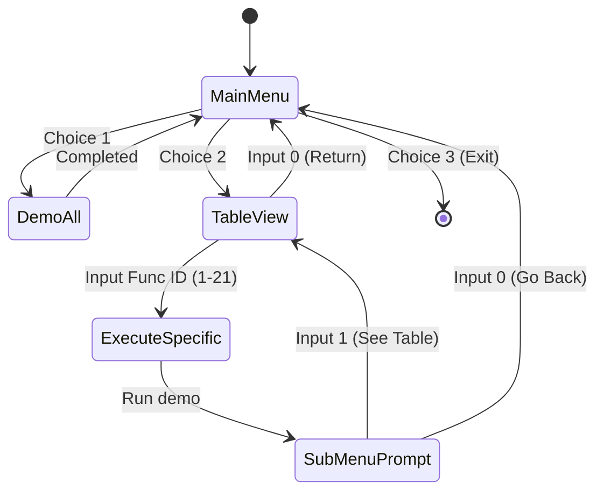

# Part 22: Minimal Base Driver & Interactive Function Demo ([main.cpp](file:///d:/GitHub/UITS/Compiler-Lab-Codes/doc/Assignments/A4_b1t_Lang/main.cpp))

- **Conversation ID**: `7612e7e1-700d-48d5-acc2-c249944d42fa`
- **Timestamp**: `2026-11-01T11:08:00+06:00`
- **Model**: `Gemini 3.8 Flash`
- **Target File**: [`doc/Assignments/A4_b1t_Lang/main.cpp`](file:///d:/GitHub/UITS/Compiler-Lab-Codes/doc/Assignments/A4_b1t_Lang/main.cpp), [`doc/Assignments/A4_b1t_Lang/main.h`](file:///d:/GitHub/UITS/Compiler-Lab-Codes/doc/Assignments/A4_b1t_Lang/main.h)

## Table of Contents
1. [User Request](#1-user-request)
2. [Code Inspected / Modified](#2-code-inspected--modified)
3. [Analysis & Key Insights](#3-analysis--key-insights)
4. [Final Solution & Output](#4-final-solution--output)

---

## 1. User Request
The user requested refactoring [`doc/Assignments/A4_b1t_Lang/main.cpp`](file:///d:/GitHub/UITS/Compiler-Lab-Codes/doc/Assignments/A4_b1t_Lang/main.cpp) and [`doc/Assignments/A4_b1t_Lang/main.h`](file:///d:/GitHub/UITS/Compiler-Lab-Codes/doc/Assignments/A4_b1t_Lang/main.h):
> `main.cpp`: I want to keep the base code minimal and for demo purpose. Add the entire code to `main.h` that shows the demo of all the defined functions. And for the `main.cpp` add the choice to:
> 1. show all function usage or 
> 2. see specific function usage chosen from the table of all functions. 
> 3. exit
>
> The choice 2 should be wrapped in a while loop so user can repeat the function demo. Here 2 inputs should be allowed inside the while loop after each loop. Pressing `0` to go back and `1` to see the table. Pressing `0` will show choice 1 again.

---

## 2. Code Inspected / Modified
1. Inspected [`doc/Assignments/A4_b1t_Lang/main.cpp`](file:///d:/GitHub/UITS/Compiler-Lab-Codes/doc/Assignments/A4_b1t_Lang/main.cpp) and [`doc/Assignments/A4_b1t_Lang/main.h`](file:///d:/GitHub/UITS/Compiler-Lab-Codes/doc/Assignments/A4_b1t_Lang/main.h).
2. Extracted the comprehensive DSL demo suite from `main.cpp` into [`doc/Assignments/A4_b1t_Lang/main.h`](file:///d:/GitHub/UITS/Compiler-Lab-Codes/doc/Assignments/A4_b1t_Lang/main.h), creating:
   - `show_function_table()`: Formatted ASCII catalog of all 21 DSL functions, loop macros, and stream aliases.
   - `demo_specific(int id)`: Dedicated test harness for profiling any individual function by its catalog ID.
   - `demo_all()`: The complete demonstration suite including dynamic vector calculations, loop macros, variadic math, and logical operators.
3. Refactored [`doc/Assignments/A4_b1t_Lang/main.cpp`](file:///d:/GitHub/UITS/Compiler-Lab-Codes/doc/Assignments/A4_b1t_Lang/main.cpp):
   - Reduced driver to an elegant, minimal CLI menu controller.
   - Implemented Tier-1 top-level menu (Choices 1, 2, 3).
   - Implemented Tier-2 nested `while` loop for Choice 2 with two allowed post-demo inputs: `1` (re-display table and test another function) and `0` (break to Tier 1, showing Choice 1 again).
   - Maintained mandatory theory summary footers on both files.
4. Updated theory documentation [`doc/Assignments/learning/A4_theory.md`](file:///d:/GitHub/UITS/Compiler-Lab-Codes/doc/Assignments/learning/A4_theory.md):
   - Added Section 17: *Interactive Driver Architecture & Modular Demo Harness*.
   - Documented the Driver Decoupling pattern, Two-Tier State Navigation Machine (Mermaid diagram), and Function Catalog mapping.
   - Synchronized clickable Table of Contents (TOC).

---

## 3. Analysis & Key Insights

### 1. Minimal Driver Architecture
In compiler and systems software development, decoupling execution harnesses from driver entry points improves maintainability and extensibility:
- **`main.h`** acts as both the core DSL runtime and the self-documenting test suite.
- **`main.cpp`** remains minimal, cleanly handling user stream interactions without cluttering the business logic.

### 2. Two-Tier Navigation State Machine
- **Tier 1 (Outer Loop)**:
  - Dispatches `demo_all()` (Choice 1), table navigation (Choice 2), or graceful shutdown (Choice 3).
- **Tier 2 (Choice 2 Inner Loop)**:
  - Prompts for a function ID from the table.
  - Executes `demo_specific(func_id)`.
  - Prompts strictly for navigation control:
    - Input `1`: Re-displays table and repeats function selection.
    - Input `0`: Breaks inner loop, transitioning back to Tier 1 where Choice 1/2/3 is displayed again.



---

## 4. Final Solution & Output

### 1. Header Implementation ([`doc/Assignments/A4_b1t_Lang/main.h`](file:///d:/GitHub/UITS/Compiler-Lab-Codes/doc/Assignments/A4_b1t_Lang/main.h))
Contains all DSL definitions plus:
- `show_function_table()`: Prints formatted 21-function catalog.
- `demo_specific(int id)`: Executes focused test case for chosen function.
- `demo_all()`: Runs dynamic vector calculation and all DSL function/macro tests.

### 2. Driver Implementation ([`doc/Assignments/A4_b1t_Lang/main.cpp`](file:///d:/GitHub/UITS/Compiler-Lab-Codes/doc/Assignments/A4_b1t_Lang/main.cpp))
```cpp
#include "main.h"

main {
  int choice;
  while (true) {
    out << "\n==========================================" << endl;
    out << "     b1t_Lang Custom DSL Demonstration    " << endl;
    out << "==========================================" << endl;
    out << "1. Show all function usage" << endl;
    out << "2. See specific function usage from table" << endl;
    out << "3. Exit" << endl;
    out << "Enter your choice (1-3): ";

    if (!(in >> choice)) {
      in.clear();
      in.ignore(numeric_limits<streamsize>::max(), '\n');
      break;
    }

    if (choice == 1) {
      demo_all();
    } else if (choice == 2) {
      show_function_table();
      while (true) {
        out << "\nEnter function number (1-21) to demo (or 0 to go back): ";
        int func_id;
        if (!(in >> func_id)) {
          in.clear();
          in.ignore(numeric_limits<streamsize>::max(), '\n');
          break;
        }
        if (func_id == 0) {
          break; // Return to main menu
        }

        demo_specific(func_id);

        out << "\nPress '0' to go back, '1' to see the table: ";
        int sub_choice;
        while (true) {
          if (!(in >> sub_choice)) {
            in.clear();
            in.ignore(numeric_limits<streamsize>::max(), '\n');
            sub_choice = 0;
            break;
          }
          if (sub_choice == 0 || sub_choice == 1) {
            break;
          }
          out << "Invalid input! Press '0' to go back, '1' to see the table: ";
        }

        if (sub_choice == 0) {
          break; // Exit choice 2 loop -> displays choice 1 main menu again
        } else if (sub_choice == 1) {
          show_function_table();
        }
      }
    } else if (choice == 3) {
      out << "Exiting b1t_Lang Demonstration. Goodbye!" << endl;
      break;
    } else {
      out << "Invalid choice! Please choose 1, 2, or 3." << endl;
    }
  }

  return 0;
}
```

### 3. Verification & Compilation
Compiled with strict flags under C++20:
```bash
g++ -Wall -Wextra -std=c++20 doc/Assignments/A4_b1t_Lang/main.cpp -o doc/Assignments/A4_b1t_Lang/main.exe
```
Tested with automated test streams:
- Verified Choice 1 executes dynamic vector math and all DSL language constructs.
- Verified Choice 2 displays table, allows repeat testing of individual functions (e.g., `pwr` and `sum`), respects `1` (see table) and `0` (go back to Choice 1 menu), and Choice 3 terminates cleanly.

